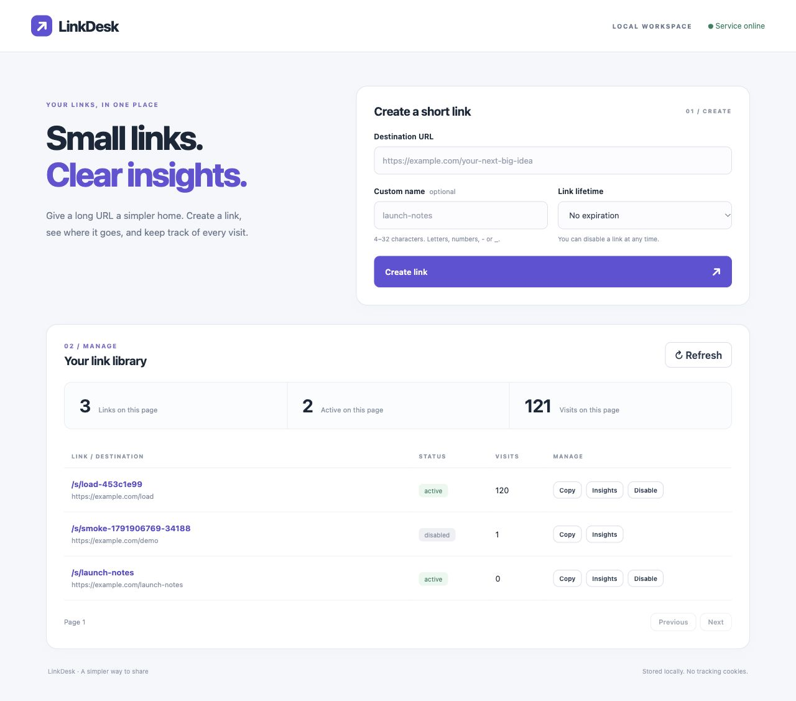

# LinkDesk

A small Java + Spring Boot URL shortener with a browser dashboard, persistent H2 storage, expiration, custom names and daily visit analytics.

## Run locally

Requires **JDK 17 or 21**. Maven is included through its official wrapper. The first run downloads dependencies.

```sh
./scripts/run.sh
```

Open **http://localhost:8092**. No Docker, external database, API key or frontend build is needed. On Windows: `mvnw.cmd spring-boot:run`.

```sh
PORT=8093 ./scripts/run.sh       # choose another port
./mvnw verify                  # tests + coverage + formatting + static analysis
./scripts/smoke.sh              # requires the running app; curl and Bash
java scripts/LoadCheck.java     # optional small HTTP concurrency probe
```

`PUBLIC_ORIGIN` overrides the short-link origin when necessary. The default follows `PORT`. `BASE_URL` sets the smoke script target. The application binds to `127.0.0.1`; H2 files are stored under `data/` and survive restarts. Stop the app before rebuilding a JAR currently being executed.

To run a packaged build:

```sh
./mvnw verify
java -jar target/linkdesk-1.0.0.jar
```

## Features

- Eight-character random short codes or a normalized custom name.
- Create, browse, copy, inspect and disable links in the dashboard.
- HTTP 302 redirects; HEAD checks do not increment counters.
- Optional lifetime from 1 minute to 1 year; exact expiration boundary is enforced.
- Total visits and a zero-filled 30-day UTC chart.
- Database-backed uniqueness, bounded collision retries and serialized link lifecycle operations.
- Atomic aggregate/daily counts: a storage failure returns 503 and rolls back the visit.
- Persistent local H2, health endpoint, safe response headers and parameterized queries.

## API at a glance

| Method | Path | Purpose |
|---|---|---|
| POST | `/api/links` | Create `{ "url": "https://example.com", "alias": "notes", "expiresInMinutes": 60 }` |
| GET | `/api/links?limit=20&offset=0` | List saved links, including inactive links |
| GET | `/api/links/{code}` | Link metadata and total visits |
| GET | `/api/links/{code}/stats` | Last 30 UTC dates and counts |
| DELETE | `/api/links/{code}` | Idempotently disable; retain code reservation |
| GET / HEAD | `/s/{code}` | Resolve an active link; GET counts a visit |
| GET | `/actuator/health` | Local service/database health |

Only `url` is required. Aliases are trimmed/lowercased, 4–32 characters, starting with a letter or digit. Valid characters: letters, digits, hyphens and underscores. Blank alias means random generation. Missing/null lifetime means no expiration. Unknown, disabled and expired links return 404, 410 and 410 respectively. Conflicting names return 409. See the [OpenAPI contract](docs/openapi.json).



## Engineering evidence

- [Architecture and decisions](docs/architecture.md)
- [Greenfield, brownfield and ambiguous scenarios](docs/scenarios.md)
- [AI-assisted work log](docs/ai-work-log.md)
- [Validation results and limitations](docs/validation.md)
- [Small HTTP workload measurements](docs/performance.json)

This is a new standalone implementation prepared for Rakesh Thoutam with AI assistance. Human review and final submission approval remain with the project owner.

## Scope

Designed for a local assessment demo. Authentication, multi-user ownership, abuse/rate controls, TLS deployment and managed schema migrations are outside this prototype. Do not expose the management API to an untrusted network without those controls. Destination URLs are not fetched or checked for malicious content. Counts represent requests, not unique people; no IP addresses, browser fingerprints or cookies are collected.
