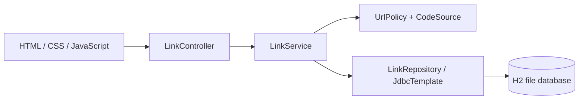

# Architecture and decisions

## Components

One Spring Boot process serves both the UI and JSON API. There is no build step for the frontend and no separate cache or analytics worker. Explicit JDBC makes transaction boundaries and query behavior visible. Prepared parameters are used for every external value. The H2 schema is in `src/main/resources/schema.sql`.

## Storage

`links`: code primary key, destination, creation/expiration epoch milliseconds, enabled state, aggregate visits and last visit. `daily_visits`: composite primary key (code, UTC date), count, foreign key to links. The creation index supports deterministic pagination by creation descending, then code. Data files are ignored by Git.

Schema initialization is idempotent/additive, suitable for this prototype. It is not a general migration system. The daily table can be added to the baseline without altering link rows; a compatibility test confirms old counts survive. Historical aggregate counts are not retroactively backfilled into the new daily table.

## Creation and collisions

URL policy accepts syntactically valid HTTP(S) addresses without embedded credentials or control characters. It converts non-ASCII paths to URI-safe form and bounds the final stored length. It never fetches a destination. Aliases are normalized before insertion. `SecureRandom` chooses eight Base62 characters (~47.6 bits of space); the database primary key decides uniqueness. Each insert has its own autocommit transaction. A duplicate random code retries up to five times; alias conflict is immediately 409. Exhaustion returns 503. A failed transaction is never reused for a retry.

## Redirect and disable ordering

GET obtains the link row using `SELECT ... FOR UPDATE` inside one Spring transaction. After acquiring the lock, it reads the clock, checks enabled/expiration state, increments the aggregate count, and increments/inserts that day's UTC bucket. Both changes commit together before returning 302. Any storage failure rolls both back and returns 503. This chooses exact accounting over redirect availability during a database outage.

Disable locks the same row, then sets only `enabled=false`, preserving counters. Competing GETs/disable operations serialize. A GET admitted before disable may finish returning after disable; after disable completes, a new GET cannot be admitted. Inactive aliases remain reserved.

HEAD is a read-only inspection and does not lock/count. It reflects state at lookup time. All responses use no-store. This prevents a cached redirect from bypassing future expiry/deactivation checks. Expiration is `now >= expiresAt`. A `Clock` dependency makes exact-boundary tests deterministic.

## Analytics and privacy

A visit is one successful GET to a short link, including repeat visits and GET-based crawlers. HEAD, missing/expired/disabled links and failed transactions do not count. The stats response contains 30 dates including today, all UTC, zero-filled for empty days. Total visits may cover an older period than the chart. No raw request events, IPs, user-agent strings, referrers or cookies are stored.

## Local reliability and boundaries

The pool allows eight connections, and lock waits have a five-second database timeout. Hot links serialize and are a deliberate throughput trade-off. Health checks H2 without any other services. DEBUG logs describe events without logging destination URLs or request bodies. Response headers restrict scripts to local assets, disallow framing, prevent MIME sniffing and omit referrers. Host headers do not control short URLs; a configured public origin does.

Future public deployment needs authentication/authorization, per-owner isolation, traffic limits, malicious-link reporting, durable database operations/backups, migrations, body-size limits and monitoring. API portability to another database, distributed performance and backup restoration are not claimed.
